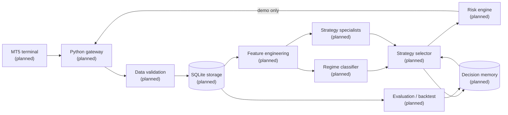

# mt5-sclapingbot

> Research project for adaptive, risk-aware short-timeframe trading on MetaTrader 5.

**Maintainer:** [@tito-devsec](https://github.com/tito-devsec)
**Development status:** 🚧 **Pre-implementation**: the repository currently contains project documentation only. No trading, data-collection, or machine-learning code has been written yet.

**Suggested GitHub topics:** `mt5` · `metatrader5` · `algorithmic-trading` · `scalping-bot` · `machine-learning` · `adaptive-trading` · `quantitative-finance` · `python` · `forex` · `risk-management`

> [!WARNING]
> This project is not a working trading bot. It is not production-ready, has no demonstrated profitability, and must not be connected to a live brokerage account. See [Risk disclosures](#risk-disclosures).

---

## Table of contents

- [Project overview](#project-overview)
- [Features and implementation status](#features-and-implementation-status)
- [Architecture](#architecture)
- [Repository structure](#repository-structure)
- [System requirements](#system-requirements)
- [Installation](#installation)
- [Configuration reference](#configuration-reference)
- [Usage](#usage)
- [Machine-learning methodology](#machine-learning-methodology)
- [Testing and validation](#testing-and-validation)
- [Risk disclosures](#risk-disclosures)
- [Security](#security)
- [Troubleshooting](#troubleshooting)
- [Roadmap](#roadmap)
- [Contributing, license, and support](#contributing-license-and-support)

---

## Project overview

### Goal

`mt5-sclapingbot` aims to become a research platform for short-timeframe ("scalping") trading strategies on MetaTrader 5 (MT5). It would collect market data, evaluate strategies under realistic costs, and use machine learning to decide **which** strategy to use, if any, under current market conditions.

### The problem it addresses

Fixed-rule scalping bots apply the same entry and exit logic in every market. A rule that works in a trending market often loses money when the market is ranging, and the reverse is also true. Short-timeframe strategies are also very sensitive to spreads, commissions, and slippage. A strategy can look profitable before costs and lose money after them.

### Intended approach

The **planned** design differs from a fixed-rule bot in four ways:

1. **Regime awareness.** The bot would classify the current market state, for example trending, ranging, or high-volatility.
2. **Strategy selection.** It would choose among specialist strategies, such as trend-following and breakout, or abstain from trading, based on regime and measured historical performance.
3. **Persistent memory.** It would record each decision and outcome so that strategy performance is measured over time, not assumed.
4. **Risk controls first.** A risk engine would have the final say on every action and could not be bypassed by a model.

### Research prototype vs. validated trading system

A research prototype shows that an idea *can be implemented*. A validated trading system has shown, through out-of-sample, cost-aware backtesting and an extended demo forward test, that its behaviour is understood and its risks are bounded. This project is at neither stage yet: it is at the design stage.

---

## Features and implementation status

Status meanings: **Implemented** means code exists and is tested. **Partial** means some code exists. **Planned** means it is intended but not started. **Not Verified** means its existence cannot be confirmed.

**All features below are Planned.** The repository contains no source code at this time.

| Feature | Status | Relevant files | Notes or limitations |
|---|---|---|---|
| MetaTrader 5 connectivity | Planned | — | Expected to use the official `MetaTrader5` Python package (Windows only). |
| Broker and account validation | Planned | — | Should refuse to run on non-demo accounts until validation is complete. |
| Historical market-data collection | Planned | — | |
| Multi-timeframe data | Planned | — | |
| Candle validation and deduplication | Planned | — | |
| SQLite storage | Planned | — | |
| MQL5 monitoring | Planned | — | |
| Technical indicators | Planned | — | |
| Market-regime detection | Planned | — | |
| Trend-following strategies | Planned | — | |
| Breakout strategies | Planned | — | |
| Machine-learning training | Planned | — | |
| Strategy selection | Planned | — | |
| Online learning | Planned | — | Research item; may not be adopted. |
| Concept-drift detection | Planned | — | |
| Performance evaluation | Planned | — | |
| Backtesting | Planned | — | |
| Walk-forward validation | Planned | — | |
| Demo forward testing | Planned | — | |
| Model versioning | Planned | — | |
| Persistent decision memory | Planned | — | |
| Risk management | Planned | — | |
| Order execution | Planned | — | Will be the **last** capability built, and demo-only by default. |
| Monitoring and logging | Planned | — | |

---

## Architecture

No architecture is implemented yet. The diagram below is a **proposed** design and will change as the implementation plan is finalized. Every component in it is **planned**.



---

## Repository structure

```
mt5-sclapingbot/
├── .github/
│   ├── ISSUE_TEMPLATE/
│   │   ├── bug_report.md        # Bug report template
│   │   ├── config.yml           # Issue-chooser configuration
│   │   └── feature_request.md   # Feature request template
│   └── PULL_REQUEST_TEMPLATE.md # Pull request checklist
├── .gitignore                   # Ignore rules for secrets, data, models, environments
├── CHANGELOG.md                 # Change history (Keep a Changelog format)
├── CODE_OF_CONDUCT.md           # Contributor Covenant 2.1
├── CONTRIBUTING.md              # Contribution policy
├── LICENSE                      # MIT License
├── README.md                    # This file
├── docs/
│   └── IMPLEMENTATION_PLAN.md   # Phased build plan (proposed)
└── SECURITY.md                  # Vulnerability reporting policy
```


---

## System requirements

These are the **expected** requirements. They are not verified, because no code exists yet.

| Requirement | Expected value | Notes |
|---|---|---|
| Operating system | Windows | The official `MetaTrader5` Python package only supports Windows. |
| Python | 3.12 (planned pin) | The `MetaTrader5` package ships Windows wheels for 3.6–3.14. Current numpy and scipy require ≥ 3.12. |
| MetaTrader 5 terminal | Required, installed and logged in | The Python API talks to a running terminal. |
| Broker account | **JustMarkets demo account**, USD | Live accounts are out of scope. Order execution is not part of this project's current scope. |
| Internet | Required | For terminal connectivity and data download. |
| Terminal open during operation | Expected: yes | |
| Storage | Unknown | It depends on the symbols, timeframes, and history depth chosen. |

---

## Installation

No installation is possible yet, because there is no code or dependency manifest. Once code exists, this section will give tested Windows PowerShell steps covering:

1. Installing Python.
2. Installing and configuring the MT5 terminal with a demo account.
3. Cloning the repository.
4. Creating a virtual environment.
5. Installing dependencies.
6. Creating local configuration from example files.
7. Running connection checks.
8. Collecting historical data.
9. Running tests.
10. Compiling the MQL5 monitoring component, if one is built.

---

## Configuration reference

None yet: no configuration keys exist. When configuration is added, this section will document each key's name, purpose, type, default, validation rules, whether it is secret, and whether changing it requires a restart.

Two design rules already apply:

- An *expected starting balance* in configuration is a reference value only. It is never presented as a verified account balance. Account values must be read from the terminal.
- Credentials are never stored in tracked files.

---

## Usage

No commands are available yet.

---

## Machine-learning methodology

**No ML functionality exists.** The intended methodology below is **planned only** and is subject to change:

- **Regime classification:** label market states, for example trend, range, or volatility, using only information available at decision time.
- **Specialist strategies:** separate trend-following and breakout models, rather than one model for all conditions.
- **Feature engineering:** price, volatility, and session features computed without look-ahead.
- **Label construction:** outcomes measured **after** spread, commission, and estimated slippage.
- **Chronological splits:** train, validation, and test sets ordered in time, with no random shuffling across time.
- **Walk-forward testing:** repeated re-training and testing on rolling windows.
- **Champion vs. challenger:** a new model replaces the current one only if it beats it out of sample.
- **Concept-drift detection:** monitor for degradation and fall back or abstain.
- **Persistent strategy performance:** record per-regime, per-strategy results.
- **Model versioning and rollback:** every deployed model is reproducible and reversible.
- **Confidence thresholds and abstention:** "no trade" is a valid and expected output.

---

## Testing and validation

- **Available tests:** none.
- **MQL5 compilation:** not applicable yet. When MQL5 code is added, it must be compiled in MetaEditor, which only runs on Windows.

### Limits of backtesting

Historical backtests can be distorted by:

- overfitting
- look-ahead bias
- survivorship and data-quality problems
- unrealistic fills
- missing spread, commission, swap, or slippage costs

A good backtest is necessary but not sufficient. An extended **demo forward test** is required before any result is taken seriously.

---

## Risk disclosures

- Trading foreign exchange, CFDs, and other leveraged products involves **substantial financial risk**. Losses can be rapid and can exceed your expectations. Depending on your broker and jurisdiction, losses can exceed your deposit.
- **Machine learning cannot guarantee profitability.** Models can fail suddenly when market conditions change.
- **Historical results do not guarantee future performance.**
- Backtests can be distorted by overfitting, look-ahead bias, unrealistic fills, and incomplete transaction costs.
- Leverage, spreads, execution quality, and symbol specifications vary by broker.
- This software is a **research and development project**. It is not financial advice, and it is not a validated trading system.
- **You are solely responsible** for your brokerage accounts, trading decisions, and compliance with the laws of your jurisdiction.

No performance figures are published, because none exist.

---

## Security

- **Never commit** broker logins, passwords, server names tied to your account, account numbers, API tokens, or private keys.
- Keep secrets in environment variables or an untracked local file such as `.env`. The `.gitignore` already excludes these.
- Local databases, logs, collected market data, and model artifacts are ignored by default. They can reveal account activity and should stay private.
- Review dependency changes and pin versions once a dependency manifest exists.
- Remote-deployment credentials, such as VPS or SSH keys, must never be stored in this repository.
- To report a vulnerability, see [SECURITY.md](SECURITY.md).

---

## Troubleshooting

There is nothing to troubleshoot yet. This section will cover issues such as the terminal not running, wrong account type, currency mismatch, broker symbol suffixes, missing history, dependency installation, SQLite paths, and MQL5 compilation, once the related code exists.

Account-validation and safety checks are **not** meant to be bypassed.

---

## Roadmap

There are no delivery dates. Items are listed in intended order. The detailed, phased plan is in [docs/IMPLEMENTATION_PLAN.md](docs/IMPLEMENTATION_PLAN.md).

1. **Repository foundation** *(done)*: documentation, policies, ignore rules, and license.
2. **Immediate engineering:** project layout, dependency manifest, configuration loading and validation, MT5 connection check with demo-account enforcement, historical data collection with validation and deduplication into SQLite, unit tests, and CI.
3. **Research infrastructure:** indicators and features, cost-aware backtester, chronological and walk-forward evaluation.
4. **ML research:** regime classifier, specialist strategies, strategy selector with abstention, model versioning, drift detection.
5. **Demo validation:** risk engine, demo-only order execution, MQL5 monitoring, extended forward test.
6. **Production readiness:** only considered if demo validation justifies it.

---

## Contributing, license, and support

- **Contributing:** see [CONTRIBUTING.md](CONTRIBUTING.md).
- **Code of conduct:** see [CODE_OF_CONDUCT.md](CODE_OF_CONDUCT.md).
- **Security:** see [SECURITY.md](SECURITY.md).
- **Changelog:** see [CHANGELOG.md](CHANGELOG.md).
- **Support:** open a GitHub issue. There is no other support channel.

### License

Released under the [MIT License](LICENSE). Copyright (c) 2026 Tito Oscar Mwaisengela.

The MIT License lets anyone use, copy, modify, and distribute this code, including for commercial purposes, as long as the copyright and license notice are kept. It comes with no warranty. Third-party dependencies added later keep their own licenses.

---

Maintained by [@tito-devsec](https://github.com/tito-devsec).
