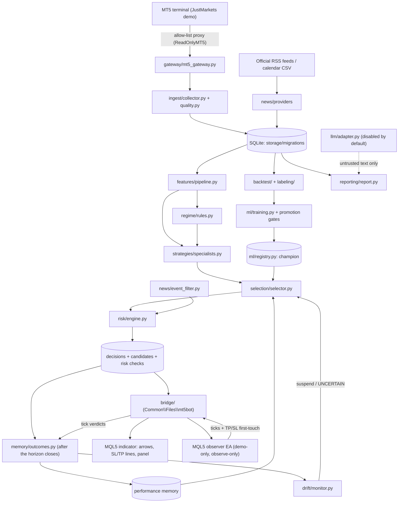

# Architecture

## Operating modes

| Mode | Where it runs | What it can do |
|---|---|---|
| Market-data ingestion | `ingest/` via the read-only gateway | Download closed bars from the demo terminal into SQLite |
| Research and inference | `pipeline/inference.py` | Produce `RECOMMEND` / `NO_TRADE` / `UNCERTAIN` / `REJECTED` research records |
| Historical simulation | `backtest/`, `pipeline/jobs.py`, `replay` | Cost-aware simulation, training and evaluation |
| Demo monitoring | `monitor/service.py` | Observe the demo account and market, and record decisions (`OBSERVED_DEMO`) |
| Terminal-side view and tick verdicts | `mql5/` + `bridge/` | Draw decisions and SL/TP on charts, record ticks, resolve SL/TP first-touch live (no trading) |
| Order execution | not implemented | **Out of scope.** No code path exists, and `tests/safety/` enforces this. |

## Data flow

## Components

| Package | Responsibility |
|---|---|
| `config/` | Typed settings with strict validation, secret types, and the generated reference (`docs/CONFIGURATION.md`) |
| `core/` | Enums (`Timeframe`, `Regime`, `DecisionStatus`), errors with reason codes, logging that redacts secrets |
| `gateway/` | Read-only MT5 access, account guard, symbol resolver, server-clock conversion, retries and rate limiting, fakes |
| `storage/` | SQLite in WAL mode, forward-only migrations with automatic backup, and repository classes (all SQL lives here) |
| `ingest/` | Checkpointed, idempotent collection; closed candles only; data-quality issues recorded, never repaired |
| `features/` | Causal indicators, feature registry and docs, cross-timeframe as-of join, optional GARCH |
| `regime/` | Rule baseline with out-of-distribution handling, Gaussian HMM, change-point audit |
| `strategies/` | Versioned specifications: trend, breakout, mean-reversion (off by default) |
| `backtest/` | Trade simulator, chronological engine, metrics |
| `labeling/` | Meta-labels with `label_available_at` |
| `evaluation/` | Train/validation/test and walk-forward splits with purge and embargo; bootstrap, PSR and DSR statistics |
| `ml/` | Dataset building, model factory, training and calibration, conformal abstention, registry, gates, Optuna, SHAP |
| `selection/` | Reward, context buckets, reliability selector, offline LinUCB replay |
| `risk/` | Independent fail-closed checks with reason codes |
| `news/` | Provider interface and registry, RSS provider, calendar CSV, relevance, sentiment, event filter |
| `llm/` | Optional research adapter with schemas, cost cap, cache and request log |
| `memory/` | Delayed outcome evaluation and attribution, counterfactual candidate outcomes |
| `drift/` | Detectors and alert persistence, suspension and resolution |
| `pipeline/` | The single decision path, replay, training and backtest jobs |
| `monitor/` | Observe-only loop with per-cycle account validation, graceful shutdown and bridge sync |
| `bridge/` | CSV exchange with the MQL5 components: export decisions, levels and status; import tick verdicts and tick files |
| `backtest/ticks.py` | First-touch resolution of bars that hit both stop and target, from stored ticks or EA verdicts |
| `mql5/` | Chart indicator, observer EA and tick-export script (see `docs/MT5_INTEGRATION.md`) |
| `reporting/` | Text status, static HTML report, CSV export |
| `cli.py` | `mt5bot` entry point |

## Reconstructing a decision

Each row in `decisions` stores:

- the feature values at the decision bar (`features_json`) and the feature-set hash
- the regime and the regime model version
- the champion model id, or `null`
- the strategy version
- the configuration hash
- the ids of the news items available at that time

`strategy_candidates` holds every candidate with its score, eligibility reason and trade geometry. `risk_evaluations` holds every risk check. `decision_outcomes` and `candidate_outcomes` hold the results, which are added only after each horizon closes.

## Schema migrations

| Migration | Adds |
|---|---|
| `0001_initial` | All core tables |
| `0002_instrument_specs` | Broker contract specs captured during collection |
| `0003_candidate_outcomes` | Candidate trade geometry and counterfactual outcomes |
| `0004_tick_resolutions` | Tick-level stop/target first-touch verdicts, plus a quotes time index |

Migrations run automatically when a database is opened. A backup of a non-empty database is written first (`*.pre-vNNNN-*.bak`).
