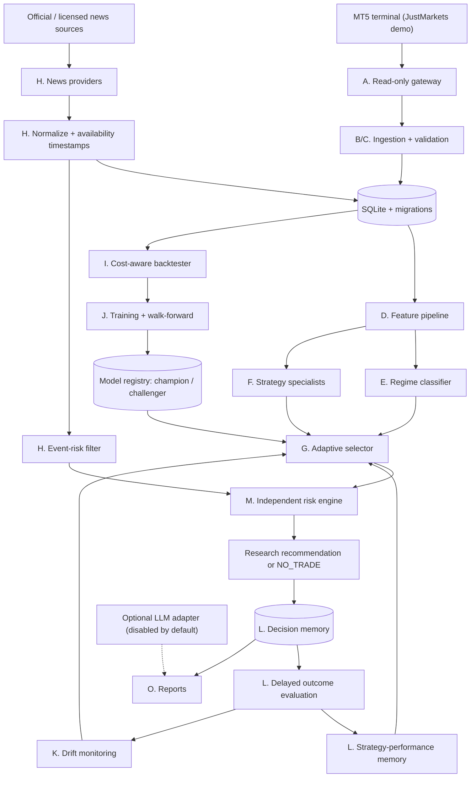

# Implementation Plan

**Status:** Version 2. Phases 0-19 are implemented and tested offline (see the README feature table for exact status); Phase 20 and every live verification step still need your Windows PC. There are no delivery dates.

This plan covers the full system, from an empty repository to a demo-monitored research system:

- data ingestion
- features
- local ML
- adaptive strategy selection
- news intelligence
- learning memory
- drift detection
- an independent risk engine
- monitoring

Each phase ends with tested deliverables and an **exit gate**, a condition that must hold before work continues past it.

---

## 1. Fixed project context

| Item | Value |
|---|---|
| Broker | JustMarkets, **demo account only** |
| Instruments | EURUSD, GBPUSD, USDJPY, XAUUSD. The broker's exact symbol names, including any suffix or prefix, are resolved from broker metadata. |
| Timeframes | M1 (entry research), M5 (short-term structure), M15 (intraday context), H1 (higher-timeframe context) |
| Account currency | USD; the code verifies it against the terminal |
| Reference balance | $1,000. This is a configured simulation value, **never** treated as a verified account balance. |
| Platform | A Windows PC first. A VPS comes later; it is optional and documented separately. |
| Python | **3.12**. The `MetaTrader5` package ships Windows wheels for 3.6–3.14; numpy 2.5 and scipy 1.18 need ≥ 3.12; `ruptures` needs < 3.14. |

## 2. Non-negotiable safety boundary

Real order execution is **out of scope and must not exist**. The system is limited to five activities:

1. market-data ingestion
2. research and inference
3. historical simulation
4. demo monitoring, which only observes the account and market
5. future execution capability, which is **not authorized** and is not built

The boundary is enforced in code and in CI:

- **Read-only gateway.** The MT5 gateway exposes read-only methods only. It never references `order_send`, `order_check`, `order_calc_*` for live use, `positions_*` modification, or any other trading call.
- **Static safety test.** A test parses every source file and fails if it finds any of: `order_send`, `OrderSend`, `OrderSendAsync`, `CTrade`, `PositionClose`, `PositionModify`, `OrderModify`, or `OrderDelete`. Documentation and the test's own deny-list are excluded explicitly and narrowly.
- **Runtime trap.** The fake MT5 module used in tests raises an error if any trading function is touched.
- **Fail closed.** Every decision path defaults to `NO_TRADE` when account validation, data integrity, model availability, or any risk check fails or cannot be completed.

---

## 3. Python ML and data stack

All libraries below have been checked on PyPI. Each has a Windows x64 wheel for Python 3.12, and each has a license compatible with distributing this project under MIT. Versions are pinned in `pyproject.toml`, and a lock file is generated in Phase 0.

The stack is split into **install extras** so the core stays light. A library is installed for a reason and used in a defined place. A model family is adopted only if it beats simpler baselines in the evaluation harness (Phase 9).

| Extra | Library | Role in this system |
|---|---|---|
| core | `numpy`, `pandas`, `scipy` | Numerical work, data frames, and statistical tests |
| core | `scikit-learn` | Pipelines, scalers fitted on training folds only, logistic regression and random-forest baselines, calibration, metrics |
| core | `statsmodels` | Stationarity tests, regression diagnostics, and robust statistics for evaluation reports |
| core | `pyarrow` | Parquet feature-snapshot cache |
| core | `skops` | Safe serialization of scikit-learn models, avoiding arbitrary pickle loading |
| `boost` | `lightgbm`, `xgboost`, `catboost` | Gradient-boosted trees for meta-labels and strategy-success estimation. All three run in the same harness, and the walk-forward results decide which one is used. Each is saved in its native model format. |
| `regime` | `hmmlearn` | Gaussian hidden Markov model for unsupervised regime discovery, compared with the rule-based regimes |
| `regime` | `ruptures` | Offline change-point detection, used to label structural breaks and to audit regime stability |
| `regime` | `arch` | GARCH-family volatility forecasts as features and as an input to the risk engine's volatility checks |
| `online` | `river` | ADWIN and Page-Hinkley drift detectors. Online models run in **shadow mode only**: they are evaluated alongside the system and never decide anything. |
| `tuning` | `optuna` | Hyper-parameter search on **validation folds only**. Every trial is counted and stored, to track multiple-testing risk. |
| `explain` | `shap` | Feature attributions for every model version, plus per-decision explanations stored in decision memory |
| `uncertainty` | `mapie` | Conformal prediction sets and intervals. A low-confidence set produces `UNCERTAIN`. |
| `uncertainty` | `imbalanced-learn` | Class rebalancing **inside training folds only**, evaluated against using no rebalancing |
| `perf` | `numba` | Compiled inner loops for the backtester and labeler |
| `deep` | `torch` (CPU) | Gated research only: a small temporal convolutional or LSTM model on M1/M5 sequences. It is adopted only if it beats the boosted-tree champion out of sample, after costs. No GPU is required. |
| `deep` | `onnxruntime` | Fast, dependency-light CPU inference for an exported deep model, if one is ever adopted |
| `tracking` | `mlflow` (local file store) | An optional browsing UI for experiments. **The SQLite model registry remains the source of truth.** |

Two other libraries were considered and deliberately excluded:

- `polars`: a second data-frame library would duplicate pandas logic for no clear gain.
- `TA-Lib` and `pandas-ta`: indicators are implemented in-house and tested against independent fixtures. This avoids a native binary dependency.

The rest of the stack: `pydantic` and `pydantic-settings` (configuration), `argparse` (CLI), `httpx` (news HTTP, with timeouts and retries), `defusedxml` and `feedparser` (safe RSS parsing), and `ruff`, `mypy`, `pytest` and `hypothesis` (quality and property-based tests).

`pip install -e ".[all]"` installs everything. `pip install -e .` gives a working rule-based and scikit-learn system.

---

## 4. Target architecture



There is exactly **one orchestration path**, and it contains no order submission:

> Market data and news → validated observations → features → regime → eligible candidates → candidate scoring → risk evaluation → research recommendation → decision record → outcome evaluation → controlled learning cycle

### Package layout

```
src/mt5bot/
  config/        settings, validation, secret redaction
  gateway/       MT5 read-only gateway, fake gateway, symbol resolver
  storage/       SQLite connection, migrations/, repositories
  ingest/        collectors, checkpoints, quality checks
  features/      indicators, feature builders, registry, docs metadata
  regime/        rule-based, HMM, supervised regime models
  strategies/    trend, breakout, mean_reversion (+ shared spec)
  labeling/      triple-barrier / meta-labels
  backtest/      engine, cost model, fills, metrics
  evaluation/    splits, purging/embargo, walk-forward, bootstrap
  ml/            trainers, model registry, promotion, calibration
  selection/     reliability-weighted selector, contextual bandit (offline)
  risk/          checks, reason codes, kill switch
  news/          provider interface, providers/, relevance, sentiment, event filter
  llm/           optional adapter, schemas, cache, budget
  memory/        decisions, outcomes, attribution, performance summaries
  drift/         PSI, Page-Hinkley/ADWIN, cost & feed monitors
  monitor/       demo monitoring service (observe only)
  reporting/     CLI tables, HTML/CSV reports
  cli.py         single entry point: `mt5bot`
tests/           unit, integration (fixtures), safety
```

---

## 5. Phases

The order differs slightly from a strict "backtester last" sequence. ML labels are simulated trade outcomes, so the **trade-simulation core** (Phase 8) must exist before ML training (Phase 10).

### Phase 0: Scaffolding and quality gates

- `pyproject.toml` with the extras from section 3, pinned versions, and a lock file. `MetaTrader5` uses an environment marker so it installs only on Windows.
- `ruff`, `mypy` (strict on `risk/`, `storage/`, `gateway/`), `pytest`, and `hypothesis` configuration.
- GitHub Actions: lint, type checks, and tests on Ubuntu and Windows with MT5 faked. Workflows get `permissions: contents: read`, Actions are pinned to commit SHAs, and secrets are never exposed to forked pull requests.
- `dependabot.yml` for pip and GitHub Actions, and `CODEOWNERS` covering `risk/`, `gateway/`, and `.github/`.
- The **static safety test** from section 2 is added on day one.

**Exit gate:** CI is green, and `pip install -e .` and `pip install -e ".[all]"` both work on Windows with Python 3.12.

### Phase 1: Configuration, secrets, and logging

- Typed settings loaded from `config/default.toml` (non-secret, tracked) and `.env` (secret, ignored). Unknown critical keys, impossible ranges, and malformed timeouts are rejected at startup.
- `.env.example` containing placeholders only.
- Settings groups:
  - MT5 validation
  - symbols and timeframes
  - collection limits
  - database path
  - features
  - ML parameters
  - evaluation thresholds
  - news providers and their API keys
  - optional LLM settings
  - timeouts and cache durations
  - cost limits
  - log level
  - risk thresholds, as both percentages and USD amounts
  - monitor intervals
- Secret values are wrapped in a type that never renders in logs, exceptions, or reports.
- Structured JSON logging with a redaction filter.

**Exit gate:** a test feeds known secrets through every log and exception path and proves they never appear in the output.

### Phase 2: MT5 read-only gateway and account validation

- A gateway interface with two implementations: a real one wrapping the `MetaTrader5` package and a deterministic fake.
- Terminal status, account metadata without the login or password, and the account guard. The guard **requires** `trade_mode == DEMO` and currency `USD`, and fails closed otherwise.
- **Symbol resolver:** match each base name against broker metadata. When the match is ambiguous (for example `EURUSD` and `EURUSD.m` both visible), stop with an error and ask for an explicit mapping in configuration. The resolver never picks one silently.
- **Server time:** detect the broker server's UTC offset by comparing the latest tick time with system UTC, with a configuration override. All timestamps are stored in UTC.
- Bounded retries with exponential backoff, reconnection handling, rate limiting, and structured error types.

**Tests:** missing terminal, failed initialization, a live (non-demo) account, wrong currency, ambiguous symbols, a missing symbol, offset detection, and reconnection.

**Exit gate:** `mt5bot check` passes against your JustMarkets demo account. This is a live verification step on your PC.

### Phase 3: Storage and migrations

SQLite in WAL mode, with versioned forward-only migrations (`storage/migrations/NNNN_*.sql`) and a `schema_version` table. Each migration runs inside a transaction, and the database is backed up automatically before a migration is applied.

| Table group | Tables |
|---|---|
| Raw observations | `bars`, `quotes`, `ingestion_runs`, `ingestion_checkpoints`, `data_quality_issues` |
| News | `news_items`, `economic_events`, `provider_status` |
| Derived | `feature_sets` (definition hash), `feature_snapshots` |
| Predictions | `regime_predictions`, `strategy_candidates`, `candidate_scores` |
| Decisions | `decisions`, `risk_evaluations` (one row per check, with a reason code) |
| Simulation | `backtest_runs`, `simulated_trades` |
| Outcomes | `decision_outcomes` (with label version), `strategy_performance` |
| ML | `model_versions`, `evaluation_runs`, `promotions`, `experiments` (including the trial count) |
| Monitoring | `drift_alerts`, `llm_requests` |

- Unique constraints, for example `bars(symbol, timeframe, time_utc)` and `news_items(fingerprint)`.
- Foreign keys and indexes.
- Parameterized SQL only, issued from repository classes, so business logic never contains SQL.
- **Separation of record types:** raw observations, derived features, predictions, simulated trades, and observed demo-account data live in separate tables, labelled with their provenance.
- **Reconstructability:** a decision row references the feature snapshot, regime prediction, model versions, strategy versions, configuration hash, and the news item IDs available at that time.

**Tests:** idempotent re-inserts; rollback on partial-write failure; migrations applied to a populated database with no data loss; concurrent reader and writer.

### Phase 4: Data ingestion and quality

- Incremental, checkpointed collection for each symbol and timeframe using `copy_rates_range`.
- **Only closed candles are stored.** The forming candle is excluded by comparing each bar's open time plus the timeframe length with the server's current time.
- Tick and quote sampling (`copy_ticks_range`) for spread and bid/ask observations, where the broker supplies them.
- Quality checks:
  - OHLC relationships
  - positive prices
  - monotonic, timeframe-aligned timestamps
  - duplicates
  - missing intervals, classified as expected (weekend or holiday) or unexpected
  - spread outliers

  Bad rows go to `data_quality_issues`. **Nothing is fabricated, forward-filled, or interpolated into the stored data.**
- Tick volume is labelled as broker tick count. It is not treated as traded volume.
- `mt5bot collect --symbols EURUSD,GBPUSD,USDJPY,XAUUSD --timeframes M1,M5,M15,H1 --from 2024-01-01` and `mt5bot inspect`.

**Tests**, using fixtures: duplicate bars, missing intervals, invalid OHLC, out-of-order records, a forming candle, timezone and DST transitions, and resuming from a checkpoint.

### Phase 5: Feature pipeline

- A feature registry. Each feature declares its inputs, warm-up period, timeframe, a calculation description, and a version. The registry generates `docs/FEATURES.md`.
- Feature families:
  - **Price action:** multi-horizon returns, body and wick ratios, range relative to ATR, consecutive bullish or bearish candles, swing highs and lows, breakout distance, and distance from recent highs and lows.
  - **Trend:** EMA relationships and slopes, ADX/DMI, and higher-timeframe alignment.
  - **Momentum:** RSI, MACD and its signal line, momentum, and acceleration.
  - **Volatility:** ATR, realized volatility, volatility percentile measured on past data only, range expansion and contraction, and GARCH forecasts (`arch`).
  - **Costs:** spread in price units, in pips, and relative to ATR; tick-volume features; commission and slippage assumptions.
  - **Session and time:** UTC hour, day of week, configurable sessions, and session transitions.
  - **Cross-timeframe:** M1 relative to M5, M5 relative to M15, and M15 relative to H1. Each joins only the **last closed** bar of the higher timeframe.
- During warm-up, features are NaN. NaN propagates and is never filled with a valid-looking value.

**Tests:**
- A look-ahead harness: features computed on data truncated at time *t* must equal the full-series features at *t*.
- Indicator values checked against independently computed fixtures.
- Timeframe alignment.
- Reproducibility: the same feature-set hash produces the same output.

### Phase 6: Market-regime classification

- **Rule baseline:** ADX, ATR percentile, and range-expansion rules produce these labels:
  - `TREND_UP` or `TREND_DOWN`
  - `RANGE`
  - `BREAKOUT_EXPANSION`
  - `HIGH_VOL` or `LOW_VOL`
  - `UNCERTAIN`, when rules conflict or inputs are out of distribution
- **Unsupervised:** a Gaussian HMM (`hmmlearn`) fitted on training folds, with its states mapped to the labels above. `ruptures` change points audit regime boundaries.
- **Supervised:** boosted trees trained on labels from the rule baseline or change points, used only if the evaluation shows they are more stable or more useful.
- Metrics: regime persistence, false-transition rate, and the frequency of each regime over time. The out-of-distribution check uses the Mahalanobis distance from the training distribution.

### Phase 7: Strategy specialists

Each strategy implements one `StrategySpec`:

- required regimes
- entry and exit criteria
- invalidation conditions
- ATR-based stop-loss and take-profit candidates
- maximum holding period
- required features
- cost assumptions
- minimum confidence

The three specialists:

- **Trend-following:** pullback entries in the direction of an EMA-aligned trend, eligible only in `TREND_*` regimes.
- **Breakout:** session-range or Donchian breakout with a volatility-expansion confirmation, eligible only in `BREAKOUT_EXPANSION` or a `RANGE` that is ending.
- **Mean-reversion (optional):** fades of Bollinger or RSI extremes, eligible only in `RANGE` with low volatility. It is disabled by default until it is validated independently.

No strategy is eligible in every regime. Parameters are versioned, and every candidate records its strategy version.

### Phase 8: Trade-simulation core and labeling

- **Fills:** a signal on bar close fills at the **next bar's open**, plus half the spread, plus slippage. Commission is configured per JustMarkets account type, because Standard and Raw-spread accounts charge differently. Swap is applied only to positions held overnight.
- **Intrabar ambiguity:** if one M1 bar touches both the stop and the target, the **stop counts first**. Tick data is used to resolve the order when it is available, and this rule is documented.
- One position per symbol and strategy. Positions do not overlap unless that is explicitly modelled.
- **Labeler:** triple-barrier labels (stop, target, time limit) and **meta-labels**: whether a strategy's candidate would be net-profitable after costs. A label is only created once its horizon has closed. Each label stores its label version.

**Tests:** spread, commission, and slippage arithmetic; stop and target hits; the ambiguity rule; no look-ahead; reproducibility; a hand-calculated reference case.

### Phase 9: Evaluation framework

- Chronological train, validation, and **untouched test** splits, using rolling or expanding walk-forward windows.
- **Purging and embargo** wherever label horizons overlap the boundary between splits.
- Preprocessing, scaling, feature selection, and rebalancing are fitted inside training folds only, enforced by scikit-learn `Pipeline`s.
- Baselines in every report:
  - no trade
  - each rule strategy on its own
  - the current champion
- Metrics:
  - net P&L in simulator USD and in R-multiples
  - trade count, win rate, and average win and loss
  - profit factor and expectancy
  - maximum drawdown and return volatility
  - Sharpe ratio, with its assumptions stated
  - exposure and holding time
  - the share of results consumed by costs
  - breakdowns by instrument, timeframe, strategy, and regime
- **Robustness:**
  - cost and slippage sensitivity grids (×0.5 to ×3)
  - parameter sensitivity
  - block-bootstrap confidence intervals
  - a probabilistic Sharpe ratio
  - a deflated Sharpe ratio that uses the stored trial count
- `optuna` runs on validation folds only. The final test set is evaluated once per frozen candidate and logged.

**Exit gate:** walk-forward baseline results are recorded. This is the benchmark ML must beat.

### Phase 10: Local ML models, registry, champion and challenger

- **Models**, in the same harness:
  - logistic regression and random-forest baselines
  - LightGBM, XGBoost, and CatBoost
  - calibration (isotonic or Platt)
  - `mapie` conformal sets for abstention
  - `imbalanced-learn` evaluated against no rebalancing
  - the `torch` sequence model as a gated experiment
- **Targets:**
  1. regime classification
  2. probability that a candidate is net-profitable (meta-label)
  3. direction, only if its labels and validation justify it
  4. ranking of strategies by regime
- **Model registry:** each version records:
  - its artifact, saved in native format (LightGBM, XGBoost, or CatBoost text or JSON, `skops` for scikit-learn, ONNX for torch) with a SHA-256 hash
  - the training window and a dataset fingerprint
  - the feature-set hash and parameters
  - metrics, SHAP summaries, the random seed, and library versions
- **Promotion gates:** a challenger is promoted only if it:
  1. beats the champion **and** the baselines on untouched walk-forward data after costs
  2. stays within the drawdown and calibration limits
  3. meets the minimum trade count
  4. survives the cost-sensitivity tests

  A failed gate leaves the champion unchanged. Rollback is a single command, and every promotion is audited.
- Training runs as an offline job and writes to a temporary file that is renamed into place atomically. A failed run cannot corrupt the champion.
- When an artifact is missing or its hash does not match, inference uses the **documented rule-based baseline** or returns `NO_TRADE`. It never silently substitutes another model.

**Tests:** reproducibility with fixed seeds; consistency between training-time and inference-time features; missing artifacts; promotion rejection; rollback.

### Phase 11: Adaptive strategy selection

- **Reward**, defined before use:
  `reward = clip(net_R, −1.5, +3.0) − 0.25 · max(0, MAE_R − 1.0)`

  `net_R` is the net result after spread, commission, slippage, and swap, divided by the initial risk distance. `MAE_R` is the maximum adverse excursion, in R. Raw price movement and win rate are never used as the reward.
- **Stage 1, reliability-weighted selector.** For each context bucket (instrument × timeframe × strategy × regime × session × volatility bucket × news context), store n, the mean reward, and the variance. Each candidate is scored by `lower confidence bound × calibrated P(success)`. A bucket with n < `min_samples` (default 30) cannot make a strategy eligible on its own; the selector then defers to the champion model or returns `NO_TRADE`.
- **Stage 2, contextual bandit** (LinUCB or Thompson sampling). It is trained and evaluated **only by offline replay** over simulated history. It replaces Stage 1 only after passing the Phase 10 promotion gates.
- **Outputs:**
  - the selected strategy
  - `NO_TRADE`, when no candidate clears its threshold
  - `UNCERTAIN`, for low confidence, an unknown regime, or poor data quality
- **Strategy lifecycle:** a strategy is suspended when drift or its performance memory shows deterioration. It is restored only after it passes a fresh evaluation.
- A single losing trade never triggers retraining or a strategy switch.

**Tests:** ranking; minimum-sample rules; `NO_TRADE`; `UNCERTAIN`; suspension and restoration; drift restrictions; a favourable prediction overridden by a risk rejection.

### Phase 12: Independent risk engine

Pure functions that take no model inputs except the uncertainty measures. Every check returns a pass or a structured rejection with a reason code, for example `RISK_SPREAD_TOO_WIDE`.

The checks:

1. account type and currency
2. data freshness
3. spread limit, in absolute terms and relative to ATR
4. volatility bounds
5. event-risk window
6. minimum reward-to-risk ratio
7. maximum risk per candidate, as a percentage and in USD against the reference balance
8. simulated daily-loss limit
9. maximum drawdown
10. consecutive-loss monitoring
11. maximum simulated exposure
12. correlated exposure across instruments, since the USD legs and gold are related
13. model uncertainty
14. missing or inconsistent data
15. strategy suspension
16. a **global emergency disable**

Limits are validated when the system starts, and neither the selector nor the LLM can modify them. When a check cannot be completed, the result is `NO_TRADE`. No percentage is claimed to be universally safe; the defaults are conservative and documented as assumptions.

**Tests:** `hypothesis` property tests showing that no generated input yields an approved candidate that breaks any limit; a test that every rejection is audited.

### Phase 13: News and economic-event intelligence

- **`NewsProvider` interface:**
  - fetch
  - normalize to UTC
  - attach source metadata
  - generate a fingerprint for deduplication
  - rate limiting
  - failure reporting
  - retrieval timestamp

  A provider registry means new sources can be added without touching the decision engine.
- **First integrations,** each verified against its official documentation and terms before any code is written. No endpoint is hard-coded without that verification.
  1. A generic **RSS/Atom provider** (`feedparser` with `defusedxml`) for sources whose terms allow automated collection.
  2. Official central-bank and statistics sources, through their published feeds or release calendars, where available and permitted: the Federal Reserve, BLS, BEA, ECB, Bank of England, and Bank of Japan.
  3. Optional licensed APIs, such as Finnhub or NewsAPI, gated behind API keys in `.env`. Their free-tier limits and permitted uses are documented, not assumed.
- **Normalized record fields:**
  - source and headline
  - published and retrieved timestamps in UTC
  - provider ID
  - URL, where permitted
  - currency and country relevance
  - category
  - importance, only when the source supplies it
  - fingerprint
  - quality status

  Article text is stored only where the provider's terms allow it.
- **Economic calendar:** scheduled time, jurisdiction, category, and importance, plus actual, forecast, and previous values **only when the source supplies them**. Scheduled events are kept separate from breaking news.
- **Relevance mapper:** deterministic rules.
  - USD news maps to EURUSD, GBPUSD, USDJPY, and XAUUSD.
  - EUR news maps to EURUSD.
  - GBP news maps to GBPUSD.
  - JPY news maps to USDJPY.
  - XAU maps to several currencies, real yields, and risk sentiment.

  Each mapping carries a relevance score and a confidence. Neither is a prediction of direction.
- **Sentiment baseline:** a local finance lexicon, with its license checked before use. A compact transformer model is an optional extra. Sentiment is only a feature, and it is adopted only if it adds out-of-sample value.
- **Historical availability rule:** a news item can only influence a decision if `available_at ≤ decision_time`, where `available_at` is the later of the publication time and the first retrieval time. Today's article collection is **never** used to simulate past knowledge.
- **Untrusted content:** headlines and article text are treated as data. They are never executed or interpreted as instructions.
- **Event-risk filter:**
  - it can flag an upcoming high-impact event or unexpected breaking news, raise uncertainty, and reject recommendations inside a configured time window
  - every rejection records its reason
  - **stale or failed feeds increase uncertainty.** An outage is never treated as evidence that there is no news.

**Tests:** provider success and failure; rate limits; duplicates; timestamp normalization; stale data; missing keys; malformed responses; news unavailable at decision time; prompt-injection text in a headline.

### Phase 14: Optional LLM research adapter

- **Disabled by default**, with a provider-neutral interface. It is used for research tasks only:
  - summarizing news the user is permitted to process
  - clustering related stories
  - explaining recorded decisions
  - proposing research hypotheses
  - summarizing evaluation and deterioration reports
- Structured outputs validated against a schema, with timeouts, retry caps, a daily cost limit, and caching.
- The `llm_requests` table logs the provider, model ID, prompt version, status, and cost. Secrets and account data are never recorded and never sent.
- **No authority:** the adapter cannot trade, change risk limits, write production configuration, or promote models. Every output is treated as an untrusted proposal.
- If the provider is unavailable, everything else carries on unaffected.

### Phase 15: Decision memory, outcomes, and attribution

- Every decision is recorded, including abstentions and risk rejections. Each record holds:
  - the timestamp, instrument, and timeframe
  - the regime and a feature-snapshot reference
  - the news context
  - the eligible candidates and their scores
  - the selection and its rationale
  - model and strategy versions
  - risk results and estimated costs
  - the candidate entry, invalidation, and exit levels
- **Delayed outcomes:** a background job evaluates a decision only after its horizon closes, then writes the outcome and its label version.
- **Rule-based attribution codes**, defined before any outcome is evaluated:
  - `VALID_LOSS`
  - `INVALID_WIN`
  - `POOR_TIMING`
  - `REGIME_MISCLASSIFIED`
  - `FAILED_BREAKOUT`
  - `TREND_REVERSAL`
  - `COST_DOMINATED`
  - `STALE_DATA`
  - `NEWS_VOLATILITY`
  - `RISK_REJECTED`
  - `UNREALISTIC_FILL_ASSUMPTION`
  - `UNATTRIBUTED`, used when the evidence is insufficient
- **Performance memory:** results by instrument, timeframe, strategy, regime, session, volatility bucket, news context, and model version. Each result is stored with its sample size and confidence interval.

### Phase 16: Concept-drift and failure detection

| Drift type | Method | Default threshold (tunable) |
|---|---|---|
| Input-data drift | Population stability index per feature, relative to the training distribution | 0.10 warning, 0.25 critical |
| Regime change | Regime-frequency chi-square test against the training period | p < 0.01 |
| Prediction quality | Rolling Brier score and calibration error compared with validation | +25% degradation |
| Strategy performance | Page-Hinkley and ADWIN (`river`) on the reward stream | Detector default, documented |
| Data-feed failure | Staleness against the expected bar cadence | 3 missed bars |
| Execution cost | Spread distribution shift (quantile or KS test) | p95 spread more than 1.5× baseline |

Each alert records a severity, a timestamp, the evidence, and a recommended response:

- raise uncertainty
- suspend a strategy
- return `NO_TRADE`
- request a re-evaluation
- keep the champion
- raise a local alert

The system **never** automatically retrains on data that may be corrupted, and never automatically promotes a model.

### Phase 17: Inference service, demo monitor, and CLI

The `mt5bot` commands:

| Command | Purpose |
|---|---|
| `check` | Terminal, account, and symbol checks |
| `collect` | Incremental historical collection |
| `news refresh` | Pull from the enabled providers |
| `features build` | Build feature snapshots |
| `train` | Train challengers |
| `evaluate` | Walk-forward evaluation |
| `backtest` | Run the simulator |
| `models compare / promote / rollback` | Champion and challenger management |
| `recommend` | Produce one research recommendation, or `NO_TRADE` |
| `monitor start` | Observe-only loop: ingest, infer, record, evaluate |
| `status` | Data freshness, provider freshness, models, and alerts |
| `report` | HTML and CSV reports |

- Inference is deterministic and records the model version. It needs no external AI call.
- The monitor shuts down gracefully on Ctrl-C or SIGTERM, cancels long jobs cleanly, and enforces resource limits on long-running jobs.

### Phase 18: Reporting and observability

- Structured logs and a status summary covering:
  - last ingestion and data freshness
  - news-provider freshness
  - models in use and training status
  - evaluation metrics and strategy performance
  - drift alerts and risk rejections
  - backtest summaries
  - errors and retries
- Static HTML reports (Jinja templates) and CSV exports. No frontend framework.
- Every figure is labelled as **SIMULATED**, **HISTORICAL**, or **OBSERVED-DEMO**.

### Phase 19: Safety verification, documentation, and VPS readiness

- Run the full test suite on Windows and Linux, the static safety scan, the secret-leak tests, `ruff`, `mypy`, `pip-audit`, and a review of the full diff.
- Rewrite the README feature table from the real implementation. Add:
  - `docs/ARCHITECTURE.md`
  - `docs/CONFIGURATION.md` (generated from the settings models)
  - `docs/FEATURES.md`
  - `docs/NEWS_PROVIDERS.md`
  - `docs/ML_GUIDE.md`
  - `docs/BACKTESTING.md`
  - `docs/RISK.md`
  - `docs/TROUBLESHOOTING.md`
- Document the VPS setup separately: paths, environment variables, and a Windows service or Task Scheduler setup. It is optional, opens no ports, and changes no firewall rules.

### Phase 20: Demo forward observation

The monitor runs observe-only on the JustMarkets demo account for a period and decision count you choose in advance. Recorded recommendations are compared with the walk-forward expectations. **Any decision about live trading needs its own separate review and authorization, outside this plan.**

---

## 6. Acceptance criteria

The project is complete when each of the following holds:

1. Every phase's exit gate has passed.
2. All tests pass in CI.
3. The static safety test finds no execution path.
4. No secrets appear in the repository, logs, or reports.
5. The documentation matches the implemented code.
6. Each live verification step has been run on the Windows PC. These are `check`, `collect`, `news refresh`, and `monitor`. Each is reported as run or not run, never assumed.

## 7. Remaining decisions

1. **JustMarkets account type** for the demo (for example Standard or Raw Spread). This sets the commission model, and the code will also verify it from terminal metadata.
2. **Holding horizon** for scalping research. The proposed default is a maximum of 60 minutes on M1 and M5.
3. **History depth** to collect. The proposal is 2 years of M1, which depends on what the broker supplies.
4. **Licensed news APIs:** whether to use any, and which. Each needs your own API key and acceptance of its terms.
